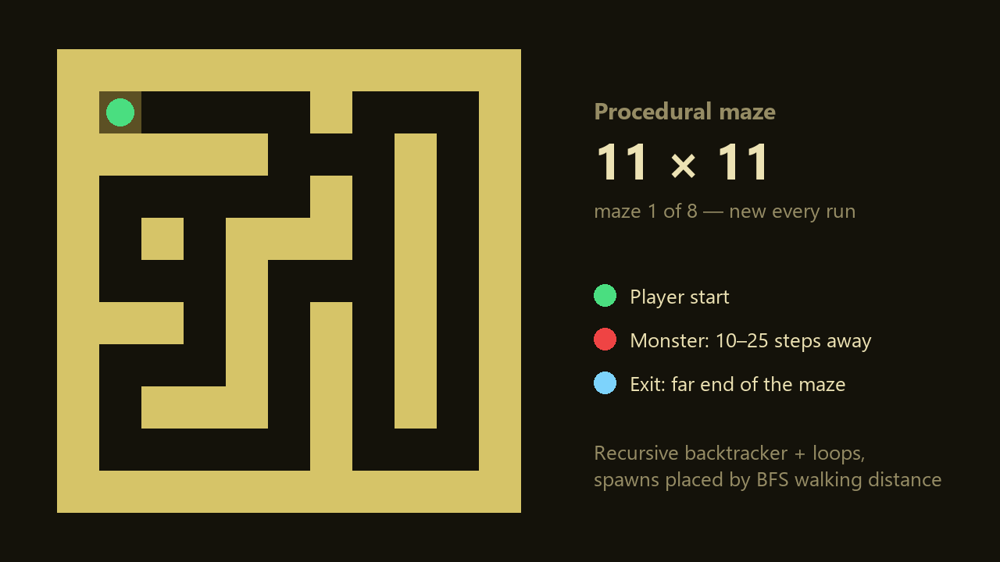

# Backrooms Maze Generator

Procedural maze generation for **The Backrooms**, a first-person horror game where the player has to escape a randomly generated maze before a monster catches them. The game was built by a team at [HACKATHON NAME] (October 2026). This repo contains the part I wrote: the maze generator and the logic that places the player, the monster and the exit.



## What it does

`generateMap(width, height)` returns a new random maze every time it's called, as a 2D grid:

| Value | Meaning |
|-------|---------|
| `0` | Floor |
| `1` | Wall |
| `2` | Player start |
| `3` | Monster start |
| `4` | Exit |

The grid is read as `maze[y][x]`. The game's raycasting renderer and the monster AI both read from it.

## How it works

**1. Carving the maze with a depth-first search (recursive backtracker)**

The grid starts as solid wall. A "digger" starts in the top-left corner and moves two squares at a time in a random direction, knocking out the wall between the old square and the new one. When it gets stuck, it backtracks along its own path (a stack) until it finds a square with an undug neighbour. When it has backtracked all the way to the start, every part of the maze has been reached. The result is one connected maze with long, winding corridors, which suits a horror game.

Rooms sit on odd coordinates and walls on even ones, so mazes should have odd sizes. That keeps a solid one-square border on every side.

**2. Adding loops**

A pure depth-first maze has exactly one path between any two points, so a monster that uses pathfinding could easily corner the player. After carving, the generator knocks out some extra walls that sit between two corridors. This creates loops, so the player has escape routes.

**3. Placing the exit and monster with a breadth-first search**

A breadth-first search from the player's start square measures the real walking distance to every floor square, following the corridors instead of straight lines.

- **Exit:** a random square at least 60% of the farthest walking distance away
- **Monster:** a random square 10–25 steps away (or the farthest square on small mazes), never on the exit

## Running the demo

`main.cpp` prints a maze to the console, so you can try the generator without the game engine.

```
cmake -S . -B build
cmake --build build
./build/maze_demo 21 21        # on Windows: build\Debug\maze_demo.exe 21 21
```

Example output (`15 x 15`):

```
##############################
##P ##          ##M         ##
##  ######  ##      ##  ##  ##
##          ##  ##  ##      ##
##############  ##  ##  ######
##      ##      ##  ##      ##
##  ##  ##  ######  ######  ##
##          ##          ##  ##
##  ##################  ######
##  ##                      ##
##      ##  ######  ####    ##
##  ##  ##  ##  ##  ##E     ##
##  ######      ##  ##  ##  ##
##          ##              ##
##############################
```

## Tech

C++17, header-only (`maze.h`), CMake for the demo. In the full game, it plugs into a DDA raycasting renderer built on the Kraken Engine.
